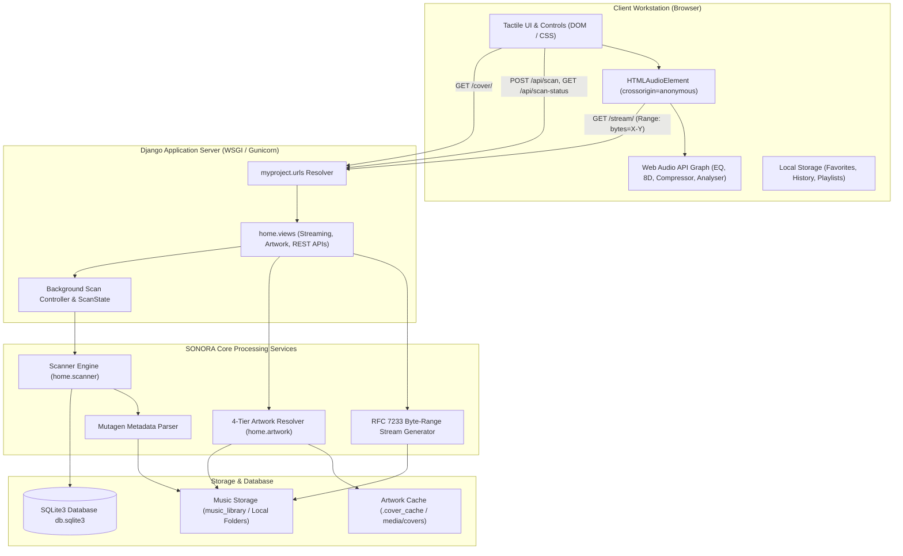
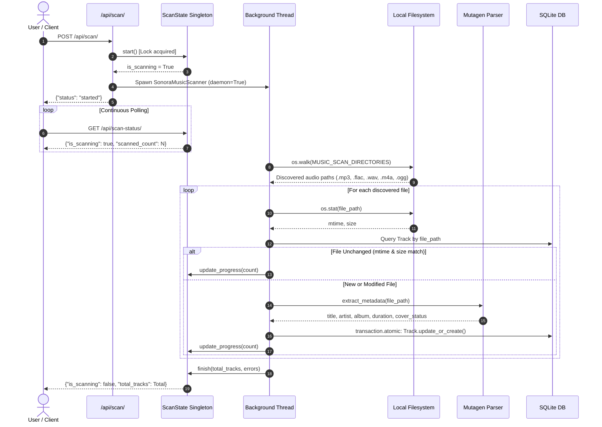
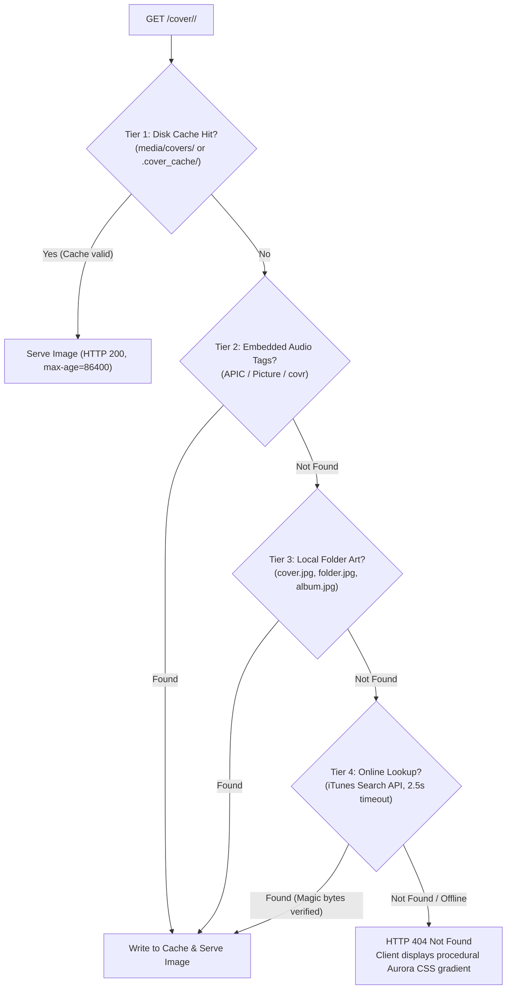

# SONORA — Backend Architecture & Data Engineering Reference

> **Evaluation Category**: Backend & Data Engineering  
> **Marks Allocated**: 15 Marks  
> **Project**: SONORA Tactile Studio Music Player  
> **Frameworks**: Django 6.1.2 · Mutagen 1.48.1 · SQLite 3 · Web Audio API

---

## 1. System Architecture Overview

SONORA is designed following Django's Model-View-Template (MVT) pattern, decoupled into a lightweight backend service delivering chunked binary streams and JSON REST APIs, and a client-side audio workstation runtime.



---

## 2. Database Models & SQLite Storage Architecture

SONORA uses SQLite 3 as its persistent database engine (`db.sqlite3`), optimized for sub-millisecond local queries, zero-configuration portability, and thread-safe read operations.

### 2.1 The `Track` Model Schema

Implemented in [`home/models.py`](file:///c:/Users/Theeran/Documents/Web%20App/home/models.py), the `Track` model encapsulates audio file metadata, storage location, and presentation attributes:

```python
class Track(models.Model):
    title = models.CharField(max_length=255)
    artist = models.CharField(max_length=255, default="Unknown Artist")
    album = models.CharField(max_length=255, default="Unknown Album")
    duration_seconds = models.FloatField(default=0.0)
    duration_formatted = models.CharField(max_length=20, default="0:00")
    file_path = models.CharField(max_length=1000, unique=True, db_index=True)
    file_size = models.BigIntegerField(default=0)
    file_mtime = models.FloatField(default=0.0)
    format = models.CharField(max_length=20, default="")
    tag = models.CharField(max_length=50, default="Local")
    has_cover = models.BooleanField(default=False)
    source_type = models.CharField(max_length=20, default="local")
    created_at = models.DateTimeField(auto_now_add=True)
    updated_at = models.DateTimeField(auto_now=True)
```

### 2.2 Physical SQLite Table Schema

The compiled SQL migration (`home/migrations/0001_initial.py`) executes the following table definition in SQLite:

```sql
CREATE TABLE "home_track" (
    "id" integer NOT NULL PRIMARY KEY AUTOINCREMENT,
    "title" varchar(255) NOT NULL,
    "artist" varchar(255) NOT NULL,
    "album" varchar(255) NOT NULL,
    "duration_seconds" real NOT NULL,
    "duration_formatted" varchar(20) NOT NULL,
    "file_path" varchar(1000) NOT NULL UNIQUE,
    "file_size" bigint NOT NULL,
    "file_mtime" real NOT NULL,
    "format" varchar(20) NOT NULL,
    "tag" varchar(50) NOT NULL,
    "has_cover" bool NOT NULL,
    "source_type" varchar(20) NOT NULL,
    "created_at" datetime NOT NULL,
    "updated_at" datetime NOT NULL
);

CREATE INDEX "home_track_file_path_idx" ON "home_track" ("file_path");
```

### 2.3 Optimization & Indexing Rationale
- **Unique B-Tree Index on `file_path`**: Guarantees $O(\log N)$ lookup performance when the scanner verifies whether a discovered file already exists.
- **Idempotency Fingerprint (`file_mtime` + `file_size`)**: Storing `st_mtime` and `st_size` directly enables the scanner to bypass expensive Mutagen parsing for unchanged files with a simple `os.stat` comparison.
- **`to_dict()` Serialization**: Optimized payload converter in the model returns pre-formatted JSON structures directly consumable by `json_script` in templates, preventing serializer overhead.

---

## 3. Local Music Scanner & Metadata Extraction Engine

The scanning engine ([`home/scanner.py`](file:///c:/Users/Theeran/Documents/Web%20App/home/scanner.py)) is designed for high-concurrency environments, long-running operations, and fault-tolerant filesystem traversal.



### 3.1 Idempotent Scanning Algorithm
To scan large libraries containing thousands of songs in seconds:
1. `os.walk` identifies files matching `settings.MUSIC_SUPPORTED_FORMATS` (`.mp3`, `.wav`, `.flac`, `.m4a`, `.ogg`).
2. `os.stat(norm_path)` retrieves file size and modification timestamp.
3. If an existing `Track` record matches `file_path` with `abs(existing.file_mtime - mtime) < 0.01` and identical `file_size`, metadata extraction is **skipped**.
4. If the file is new or modified, Mutagen parses the container tags within an atomic database transaction (`transaction.atomic()`).

### 3.2 Metadata Normalization Across Formats
Because metadata tags differ significantly across audio container formats, `extract_metadata` applies multi-key inspection:
- **MP3 (ID3v2)**: Scans for `TIT2`, `title`, `TPE1`, `artist`, `TALB`, `album`, and `TCON` tags.
- **FLAC & OGG (Vorbis)**: Reads Vorbis comment blocks (`TITLE`, `ARTIST`, `ALBUM`, `GENRE`).
- **M4A / MP4**: Reads Apple iTunes atoms (`©nam`, `©ART`, `aART`, `©alb`, `©gen`, `covr`).
- **WAV / AIFF**: Reads embedded ID3 chunk frames.
- **Vibe Classifier**: Automatically maps genres into SONORA UI vibes:
  - *Chill*: ambient, downtempo, lo-fi, lofi, piano.
  - *Electronic*: dance, synth, edm, techno, house.
  - *Acoustic*: folk, guitar, instrumental.
  - *Classics*: retro, rock, jazz, blues.

---

## 4. Multi-Tier Album Artwork Pipeline

Implemented in [`home/artwork.py`](file:///c:/Users/Theeran/Documents/Web%20App/home/artwork.py), the artwork resolver applies a 4-tier cascading strategy to ensure crisp visuals without blocking the UI thread.



### Key Technical Safeguards:
- **Cache Invalidation**: Compares the cache image file `mtime` against the source audio file `mtime`. If the audio file was retagged, the cache auto-refreshes.
- **Magic Byte Verification**: When downloading from the iTunes Search API, incoming payloads are validated against binary magic signatures:
  - JPEG: `\xff\xd8`
  - PNG: `\x89PNG`
  - WEBP: `RIFF....WEBP`
- **Network Timeout Defense**: Strict 2.5-second timeout on online queries prevents thread starvation during offline playback.

---

## 5. RFC 7233 HTTP 206 Byte-Range Streaming Engine

Standard HTTP file responses require the entire file to be downloaded before playback or seeking can occur. SONORA implements an enterprise-grade streaming engine in `home/views.py:stream_audio`.

### 5.1 Byte-Range Header Parsing
The engine parses standard RFC 7233 HTTP range headers using regular expressions:
```python
range_header = request.META.get("HTTP_RANGE", "").strip()
range_match = re.match(r"bytes=(?:(\d+)-(\d*)|-(\d+))", range_header)
```
- **Explicit Range (`bytes=0-1048575`)**: Buffers the first 1 MB segment.
- **Open-Ended Range (`bytes=1048576-`)**: Reads from byte 1,048,576 to the end of the file (`file_size - 1`).
- **Suffix Range (`bytes=-500`)**: Reads the last 500 bytes of the file (`file_size - 500` to `file_size - 1`).

### 5.2 Memory Safety via Chunked Streaming
Loading an uncompressed 50MB WAV or 30MB FLAC file into RAM for every client request would rapidly exhaust server memory. SONORA streams using Python generator iterators yielding 64KB (`65,536` bytes) chunks:

```python
def file_iterator(start, end, block_size=64 * 1024):
    f = open(path_obj, "rb")
    try:
        f.seek(start)
        remaining = end - start + 1
        while remaining > 0:
            read_len = min(remaining, block_size)
            data = f.read(read_len)
            if not data:
                break
            remaining -= len(data)
            yield data
    finally:
        f.close()
```

### 5.3 Streaming Response Headers
Every 206 response emits the required HTTP streaming headers:
```http
HTTP/1.1 206 Partial Content
Accept-Ranges: bytes
Content-Range: bytes 0-1048575/15728640
Content-Length: 1048576
Content-Type: audio/mpeg
Access-Control-Allow-Origin: *
Access-Control-Expose-Headers: Content-Range, Content-Length, Accept-Ranges
```

---

## 6. RESTful API Endpoints Reference

| Endpoint | Method | Input Parameters | Output Response | Description |
| :--- | :--- | :--- | :--- | :--- |
| `/` | `GET` | None | HTML (Django Template) | Renders the primary tactile studio interface and pre-populates initial tracks JSON. |
| `/stream/<int:track_id>/` | `GET` | Optional `Range` Header | Binary Audio Stream (`206` or `200`) | Streams audio content with byte-range seeking and CORS compatibility. |
| `/cover/<int:track_id>/` | `GET` | None | Image Binary (`image/jpeg`, `png`, `webp`) | Serves cached/extracted artwork with `Cache-Control: public, max-age=86400`. |
| `/api/scan/` | `POST` | None | `{"status": "started"}` or `{"status": "in_progress"}` | Triggers asynchronous background library indexing thread. |
| `/api/scan-status/` | `GET` | None | `{"is_scanning": bool, "scanned_count": int, "total_tracks": int, "errors": []}` | Real-time scan telemetry polled every 800ms by client. |
| `/api/upload/` | `POST` | Multipart form (`audio_files`) | `{"status": "success", "saved_count": int, "files": []}` | Uploads audio files to `music_library/` and triggers background scan. |

---

## 7. Known Architectural Limitations & Pending Tasks

1. **Client-Side Playlist Persistence**:
   - *Current State*: Custom playlists and track favorites are stored in browser `localStorage` (`sonora_favorites`, `sonora_history`, `sonora_custom_playlists`).
   - *Pending Task*: Implement database-backed `Playlist` and `PlaylistItem` models with user relationship mappings for cross-device synchronization.
2. **SQLite Concurrent Writer Ceiling**:
   - *Current State*: Uses single-file SQLite database. Under heavy concurrent write operations (e.g., simultaneous file uploads while running multiple scans), SQLite lock contention can occur.
   - *Mitigation*: The scanning engine enforces mutex locking (`threading.Lock()`). Migration to PostgreSQL is recommended for multi-user server deployments.
3. **Scan Path Configuration**:
   - *Current State*: Configured via Python list `MUSIC_SCAN_DIRECTORIES` in `myproject/settings.py`.
   - *Pending Task*: Add a web settings panel allowing administrators to dynamically configure scan paths without modifying code.
