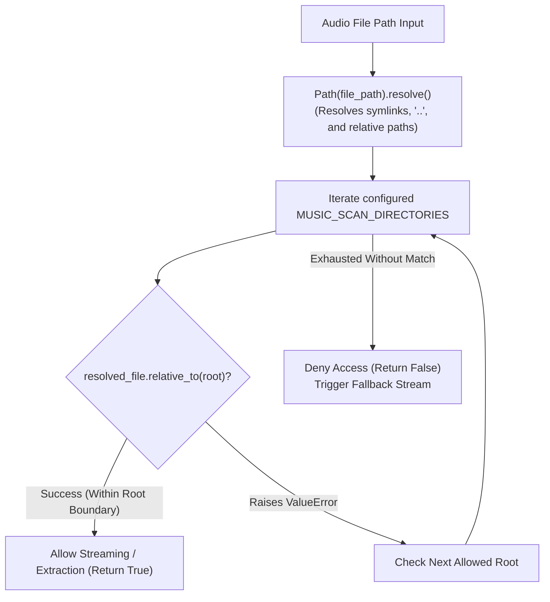

# SONORA — Deployment Architecture & Security Hardening Reference

> **Evaluation Category**: Deployment & Security Engineering  
> **Marks Allocated**: 15 Marks  
> **Project**: SONORA Tactile Studio Music Player  
> **Operating System**: Windows (Development & Host) · Linux / Docker (Production & Cloud)

---

## 1. Windows Setup & Local Deployment Guide

SONORA is designed for local-first audio workstation workflows on Windows while providing containerized parity for Linux servers.

### 1.1 Prerequisites
- **Operating System**: Windows 10 / Windows 11 (64-bit).
- **Python**: Version 3.12.x installed with "Add python.exe to PATH" enabled.
- **Shell**: Windows PowerShell 5.1+ or PowerShell 7.

### 1.2 Step-by-Step Installation

```powershell
# 1. Clone the repository
git clone https://github.com/theeran-stack/sonora.git
cd sonora

# 2. Adjust PowerShell execution policy (if script execution is restricted)
Set-ExecutionPolicy -ExecutionPolicy RemoteSigned -Scope CurrentUser

# 3. Create a dedicated Python 3.12 virtual environment
py -3.12 -m venv .venv

# 4. Activate the virtual environment
.\.venv\Scripts\Activate.ps1

# 5. Install production and development dependencies
pip install --upgrade pip
pip install -r requirements.txt
```

### 1.3 Database Initialization & Music Indexing

```powershell
# 6. Apply database migrations to create SQLite tables
python manage.py migrate

# 7. Index your local music library
# Scans directories defined in settings.MUSIC_SCAN_DIRECTORIES
python manage.py scan_music

# Optional: Scan a specific external directory directly
python manage.py scan_music --dir "D:\MyLosslessMusic"

# 8. Start the local development server
python manage.py runserver 127.0.0.1:8000
```
Access the application in your browser at `http://127.0.0.1:8000/`.

### 1.4 Production Deployment on Windows
For production hosting on Windows without the development `runserver`, use **Waitress** (a pure-Python production WSGI server designed for Windows):

```powershell
pip install waitress
waitress-serve --port=8000 myproject.wsgi:application
```

---

## 2. Containerized & Cloud Deployment

SONORA provides turnkey deployment artifacts for container platforms (Docker, Railway, Fly.io) and cloud PaaS (Render).

### 2.1 Docker Containerization

The included [`Dockerfile`](file:///c:/Users/Theeran/Documents/Web%20App/Dockerfile) uses `python:3.12-slim` to minimize image footprint and attack surface:

```dockerfile
FROM python:3.12-slim

ENV PYTHONDONTWRITEBYTECODE=1
ENV PYTHONUNBUFFERED=1

WORKDIR /app

RUN apt-get update && apt-get install -y --no-install-recommends \
    gcc \
    && rm -rf /var/lib/apt/lists/*

COPY requirements.txt .
RUN pip install --no-cache-dir -r requirements.txt

COPY . .

RUN python manage.py collectstatic --no-input

EXPOSE 8000

CMD ["gunicorn", "myproject.wsgi:application", "--bind", "0.0.0.0:8000"]
```

Build and execute the container:
```bash
docker build -t sonora .
docker run -d -p 8000:8000 -v $(pwd)/music_library:/app/music_library sonora
```

### 2.2 Cloud Deployment via Render

The repository includes a declarative [`render.yaml`](file:///c:/Users/Theeran/Documents/Web%20App/render.yaml) blueprint:
```yaml
services:
  - type: web
    name: sonora
    runtime: python
    buildCommand: pip install -r requirements.txt && python manage.py collectstatic --no-input && python manage.py migrate
    startCommand: gunicorn myproject.wsgi:application
    envVars:
      - key: PYTHON_VERSION
        value: 3.12.0
```
Static assets are served via **WhiteNoise** (`whitenoise.storage.CompressedManifestStaticFilesStorage`), eliminating the need for a separate Nginx or S3 static server.

---

## 3. Filesystem Path Validation & Path Traversal Security

### 3.1 Threat Model: Arbitrary File Disclosure via Streaming
In media players that stream local files based on database records or query parameters, attackers may attempt Directory Traversal attacks (e.g., `../../../../Windows/System32/drivers/etc/hosts` or `..\..\..\etc\passwd`) to access sensitive system files through the streaming endpoint.

### 3.2 Implemented Defense: `is_safe_music_path()`
SONORA enforces strict canonical path sandboxing in [`home/scanner.py`](file:///c:/Users/Theeran/Documents/Web%20App/home/scanner.py):

```python
def is_safe_music_path(file_path):
    """
    Validates that a file_path is strictly inside one of the allowed MUSIC_SCAN_DIRECTORIES.
    Prevents path traversal attacks and arbitrary filesystem access.
    """
    try:
        resolved_file = Path(file_path).resolve()
        for root in get_scan_directories():
            try:
                # Check if file is relative to root
                resolved_file.relative_to(root)
                return True
            except ValueError:
                continue
    except Exception as e:
        logger.warning(f"Error checking path security for {file_path}: {e}")
    return False
```



### 3.3 Verification & Unit Testing
This security mechanism is verified via automated test in [`home/tests.py:test_path_traversal_security`](file:///c:/Users/Theeran/Documents/Web%20App/home/tests.py):
```python
def test_path_traversal_security(self):
    with patch.object(settings, "MUSIC_SCAN_DIRECTORIES", [self.scan_root]):
        # File inside allowed root -> MUST PASS
        self.assertTrue(is_safe_music_path(str(self.mp3_file)))

        # File outside allowed root -> MUST FAIL
        forbidden_path = "C:/Windows/System32/drivers/etc/hosts"
        self.assertFalse(is_safe_music_path(forbidden_path))
```

---

## 4. Secure Audio Streaming & Memory Safety

### 4.1 Denial of Service (DoS) Prevention via Chunked Generators
Streaming high-resolution audio files (e.g., 24-bit/96kHz FLAC or uncompressed WAV files up to 200MB) can easily crash an application if read entirely into memory (`f.read()`).

In [`home/views.py`](file:///c:/Users/Theeran/Documents/Web%20App/home/views.py), SONORA implements **chunked memory streaming**:
- Reads in small, fixed-size blocks of **64 KB** (`65,536 bytes`).
- Emits chunks via Python generator `yield`, keeping the server memory overhead below **1 MB** regardless of audio file size.
- Closes file descriptors reliably using `try ... finally: f.close()` inside the generator.

### 4.2 Range Boundary Validation
To prevent memory overflow and index errors:
- If `first_byte >= file_size` or `first_byte > last_byte`, the view immediately terminates with **`HTTP 416 Range Not Satisfiable`** and header `Content-Range: bytes */<file_size>`.
- `last_byte` is clamped using `min(last_byte, file_size - 1)`.

---

## 5. Upload Validation & Defense-in-Depth

The `/api/upload/` endpoint allows users to upload songs directly through the browser. To prevent Remote Code Execution (RCE) or arbitrary script upload:

1. **Extension Whitelisting**:
   - Compares incoming file extensions strictly against `settings.MUSIC_SUPPORTED_FORMATS`:
     ```python
     supported = getattr(settings, "MUSIC_SUPPORTED_FORMATS", {".mp3", ".wav", ".flac", ".m4a", ".ogg"})
     ext = os.path.splitext(f.name)[1].lower()
     if ext in supported:
         # Write to disk
     ```
   - Disallowed files (`.py`, `.exe`, `.html`, `.js`, `.sh`, `.php`) are rejected immediately.
2. **Chunked Disk Streaming**:
   - Files are written to `music_library/` using `f.chunks()` to prevent memory spikes during multiple concurrent uploads.
3. **Automatic Re-indexing**:
   - Triggers `start_background_scan()` asynchronously, indexing only valid media.

---

## 6. Database Protection & Data Integrity

1. **SQL Injection Immunity**:
   - All database queries across SONORA utilize Django ORM's parameterized abstraction layer (`Track.objects.filter()`, `Track.objects.update_or_create()`). Raw SQL queries are avoided entirely.
2. **ACID Transaction Isolation**:
   - Database writes during metadata indexing are wrapped in `with transaction.atomic():`, ensuring that database indices and track records are never left in a corrupt state if scanning is interrupted.
3. **Database File Protection**:
   - The SQLite database file (`db.sqlite3`) resides outside static and media serving directories, preventing direct web downloads.

---

## 7. Production Security Hardening Checklist

Before deploying SONORA to a public domain or shared server, verify the following configuration items:

| Security Setting | Development Value | Production Target | Implementation in Django |
| :--- | :--- | :--- | :--- |
| `DEBUG` | `True` | `False` | `DEBUG = os.getenv('DJANGO_DEBUG', 'False') == 'True'` |
| `SECRET_KEY` | Hardcoded string | Environment Variable | `SECRET_KEY = os.environ['DJANGO_SECRET_KEY']` |
| `ALLOWED_HOSTS` | `['*']` | Explicit Domain Names | `ALLOWED_HOSTS = ['sonora.yourdomain.com']` |
| `SECURE_SSL_REDIRECT` | `False` | `True` | Forces all HTTP traffic to HTTPS |
| `SESSION_COOKIE_SECURE` | `False` | `True` | Transmits session cookies over HTTPS only |
| `CSRF_COOKIE_SECURE` | `False` | `True` | Transmits CSRF tokens over HTTPS only |
| `X_FRAME_OPTIONS` | `'DENY'` | `'DENY'` | Configured via `XFrameOptionsMiddleware` against clickjacking |
| `STATICFILES_STORAGE` | WhiteNoise Manifest | WhiteNoise Manifest | Hashes filenames for immutable caching & integrity |

---

## 8. Known Security & Deployment Limitations

1. **Development Settings in Repository**:
   - *Current State*: `DEBUG = True`, hardcoded `SECRET_KEY`, and `ALLOWED_HOSTS = ['*']` are present in `myproject/settings.py` to facilitate frictionless local academic testing.
   - *Limitation*: For public web deployment, these must be replaced with environment variables as detailed in the checklist above.
2. **Stateless API Authentication**:
   - *Current State*: `/api/scan/` and `/api/upload/` endpoints are decorated with `@csrf_exempt` to support asynchronous AJAX requests from the local UI without cookie state.
   - *Limitation*: In a multi-tenant or public environment, these endpoints require token or session authentication to prevent unauthorized scan triggers or uploads.
3. **Audio File Magic Byte Verification on Upload**:
   - *Current State*: Uploads are validated against file extension whitelist (`MUSIC_SUPPORTED_FORMATS`).
   - *Pending Task*: Integrate file header magic-byte verification (e.g., using `python-magic`) to ensure uploaded files with `.mp3` extension are genuine audio bitstreams.
