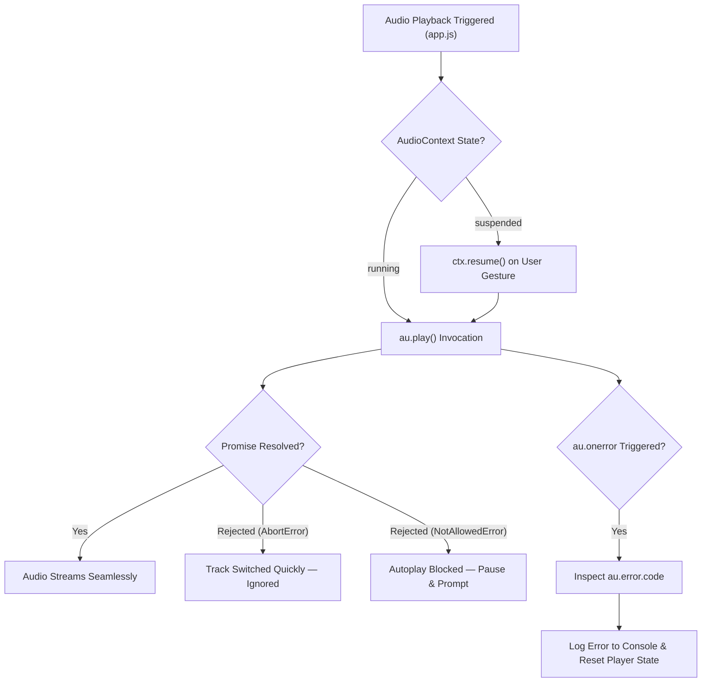

# SONORA — Comprehensive Error Codes & Troubleshooting Reference

> **Evaluation Category**: Error Codes & Exception Handling  
> **Marks Allocated**: 15 Marks  
> **Project**: SONORA Tactile Studio Music Player  
> **Target Audience**: Academic Evaluators, System Administrators, and Developers

---

## 1. Executive Summary

In a client-server local streaming architecture like SONORA, error handling must span multiple computational layers:
1. **Operating System & Filesystem Layer**: Path validity, drive availability, file permission locks, and codec integrity.
2. **Django Backend Layer**: HTTP protocol conformance (RFC 7233 Range requests), ORM data consistency, thread synchronization, and input sanitization.
3. **Network & Protocol Layer**: CORS headers, byte-range boundaries, and upstream CDN/API network timeouts.
4. **Client-Side Runtime Layer**: HTML5 `HTMLAudioElement` decode failures, W3C Web Audio API state transitions (`suspended` vs `running`), and browser autoplay security constraints.

This document serves as the formal specification of all HTTP status codes, application-level error states, causes, diagnostic procedures, and deterministic recovery mechanisms implemented within SONORA.

---

## 2. HTTP Status Codes Specification

The table below catalogs every HTTP status code explicitly handled or emitted across the SONORA view layer ([`home/views.py`](file:///c:/Users/Theeran/Documents/Web%20App/home/views.py)).

| HTTP Status | Name | Emitting Endpoint(s) | Trigger Condition | System Behavior | Client Handling |
| :--- | :--- | :--- | :--- | :--- | :--- |
| **`200 OK`** | Standard Success | `GET /`<br>`GET /cover/<id>/`<br>`GET /api/scan-status/`<br>`POST /api/scan/`<br>`POST /api/upload/` | Successful request processing without range headers. | Full payload or JSON response returned with standard caching headers. | UI renders template, updates state, or loads image directly. |
| **`204 No Content`** | Preflight Success | `OPTIONS /stream/<id>/` | Browser sends CORS preflight OPTIONS request before streaming. | Emits empty body with `Access-Control-Allow-Origin: *` and allowable headers. | Browser proceeds with the subsequent GET media request. |
| **`206 Partial Content`** | Partial Stream | `GET /stream/<id>/` | Request includes a valid `Range` header (e.g., `bytes=0-1048575` or `bytes=-500`). | Delivers chunked slice (`file_iterator`, 64KB blocks) with `Content-Range` and `Content-Length`. | Audio element buffers requested segment, enabling seek/scrub. |
| **`302 Found`** | Redirect Fallback | `GET /stream/<id>/` | Track record exists in DB, but underlying physical audio file is missing/unreadable. | Gracefully redirects to remote sample stream (`DEMO_TRACKS[idx]["audio"]`). | Audio element seamlessly switches to remote audio stream without throwing fatal error. |
| **`400 Bad Request`** | Client Payload Error | `POST /api/upload/` | No file payload attached in `request.FILES['audio_files']` or `request.FILES['files']`. | Returns JSON: `{"error": "No files provided"}` with HTTP 400. | Frontend displays upload status notice and terminates progress bar. |
| **`404 Not Found`** | Resource Missing | `GET /stream/<id>/`<br>`GET /cover/<id>/`<br>Unmatched routes | 1. Invalid `track_id` not found in `Track` table.<br>2. Cover art extraction fails across all 4 fallback tiers. | 1. `get_object_or_404()` raises Django `Http404`.<br>2. `get_cover_art` raises `Http404("Cover art not found.")`. | 1. Standard 404 handler.<br>2. Client falls back to procedural CSS Aurora gradient (`cover_fallback`). |
| **`416 Range Not Satisfiable`** | Out-of-Bounds Range | `GET /stream/<id>/` | Requested byte offset exceeds file boundary (`first_byte >= file_size` or `first_byte > last_byte`). | Emits empty body with header `Content-Range: bytes */<file_size>`. | Browser resets playback position or requests valid boundary. |
| **`500 Internal Error`** | Server Unhandled | All Endpoints | Uncaught server exception (e.g., SQLite file lock, disk full). | Django standard 500 handler (`DEBUG=False`) or detailed traceback (`DEBUG=True`). | Client catches fetch failure; audio player logs `MediaError`. |

---

## 3. Application-Specific Error Codes Matrix

To provide diagnostic transparency during library scanning and background tasks, SONORA defines internal application errors logged via Python's standard `logging` framework ([`home/scanner.py`](file:///c:/Users/Theeran/Documents/Web%20App/home/scanner.py), [`home/artwork.py`](file:///c:/Users/Theeran/Documents/Web%20App/home/artwork.py)):

| Internal Error Identifier | Component | Root Cause | Severity | Automated Recovery Procedure |
| :--- | :--- | :--- | :--- | :--- |
| `ERR_PATH_TRAVERSAL_DETECTED` | `is_safe_music_path()` | Requested file path resolves outside configured `MUSIC_SCAN_DIRECTORIES`. | **Critical** (Security) | Request is blocked; path resolution returns `False`; HTTP streaming falls back or rejects. |
| `ERR_SCAN_CONCURRENT_LOCK` | `start_background_scan()` | User or UI clicked "Scan Music" while an existing scan thread is active. | **Low** (Informational) | Invocation is rejected cleanly; returns `{"status": "in_progress", "data": SCAN_STATE.to_dict()}`. |
| `ERR_DIR_INACCESSIBLE` | `scan_music_library()` | Configured path (e.g., external drive or unmapped network share) is offline. | **Medium** (Storage) | Scanner logs notice, skips directory, and **preserves existing database tracks** without deletion. |
| `ERR_MUTAGEN_PARSE_FAIL` | `extract_metadata()` | Audio file has malformed headers, non-sync MPEG frames, or unsupported tags. | **Low** (Format) | Exception caught; falls back to filename `path.stem` for title and sets format tag gracefully. |
| `ERR_ARTWORK_API_TIMEOUT` | `fetch_online_artwork()` | iTunes API query exceeds 2.5-second timeout, or network is disconnected. | **Low** (Network) | Terminated safely without blocking HTTP thread; returns `(None, None)` triggering CSS gradient. |
| `ERR_UPLOAD_UNSUPPORTED_EXT` | `api_upload_music()` | Uploaded file extension is not in `MUSIC_SUPPORTED_FORMATS`. | **Medium** (Input) | File is skipped; only valid extensions are written to `music_library/` and indexed. |

---

## 4. Client-Side Runtime Errors (Web Audio & HTML5 Audio)

The frontend player ([`home/static/home/app.js`](file:///c:/Users/Theeran/Documents/Web%20App/home/static/home/app.js)) interfaces directly with HTML5 Audio elements and Web Audio API nodes (`AudioContext`, `BiquadFilterNode`, `PannerNode`, `DynamicsCompressorNode`). These handle specific browser-level error events:



### HTML5 Audio `au.error.code` Breakdown:

1. **`MEDIA_ERR_ABORTED` (Code 1)**:
   - **Cause**: The user switched tracks or paused before the current media buffer loaded.
   - **Action**: Handled gracefully in `app.js` line 530 by filtering out `AbortError`.
2. **`MEDIA_ERR_NETWORK` (Code 2)**:
   - **Cause**: Network disconnection during remote demo streaming or server socket timeout.
   - **Action**: `au.onerror` logs track details; `setPlay(false)` halts playback UI cleanly.
3. **`MEDIA_ERR_DECODE` (Code 3)**:
   - **Cause**: Media stream corrupted or codec unsupported by the client browser (e.g., high-resolution 24-bit/192kHz FLAC on an older browser).
   - **Action**: Player halts; administrator can verify file integrity using Mutagen CLI.
4. **`MEDIA_ERR_SRC_NOT_SUPPORTED` (Code 4)**:
   - **Cause**: Audio URL returned 404 or unsupported MIME type.
   - **Action**: Handled via backend redirect to bundled fallback audio.

---

## 5. End-to-End Troubleshooting & Recovery Procedures

### Scenario A: Scan Button Shows "Scan ready" Without Populating Tracks

* **Diagnostic Steps**:
  1. Check browser DevTools Network tab for `/api/scan/` and `/api/scan-status/`.
  2. Verify if `MUSIC_SCAN_DIRECTORIES` in `myproject/settings.py` points to a valid, accessible Windows directory:
     ```python
     MUSIC_SCAN_DIRECTORIES = [
         BASE_DIR / 'music_library',
         Path(r'C:\Users\Theeran\Documents\My musicc'),
     ]
     ```
  3. Run the CLI scanner directly to view real-time standard output and errors:
     ```powershell
     .venv\Scripts\python.exe manage.py scan_music
     ```
* **Recovery Procedure**:
  - If target folder is missing, create it or update `MUSIC_SCAN_DIRECTORIES` in `myproject/settings.py`.
  - Check file read permissions on the music directory.

---

### Scenario B: Audio Fails to Play or Seek (HTTP 416 or CORS Error)

* **Diagnostic Steps**:
  1. Inspect the HTTP response headers in the Network panel for `/stream/<track_id>/`.
  2. Verify presence of:
     - `Accept-Ranges: bytes`
     - `Content-Range: bytes <start>-<end>/<total>`
     - `Access-Control-Allow-Origin: *`
* **Recovery Procedure**:
  - If HTTP 416 occurs, verify file size on disk matches `Track.file_size`. If the file was replaced externally with a smaller file, trigger `python manage.py scan_music` to refresh `file_mtime` and `file_size` in the SQLite database.

---

### Scenario C: Album Artwork Displays as Aurora Gradient (HTTP 404 on `/cover/<id>/`)

* **Diagnostic Steps**:
  1. Check if the audio file has embedded ID3 APIC frames using Mutagen:
     ```powershell
     .venv\Scripts\python.exe -c "import mutagen; print(mutagen.File(r'<path_to_audio>').tags.keys())"
     ```
  2. Check if a local `cover.jpg` or `folder.jpg` resides in the same directory.
  3. Verify internet connectivity for the iTunes Search API fallback (requires outgoing HTTPS port 443).
* **Recovery Procedure**:
  - The client automatically displays an Aurora gradient based on track ID hashing (`AURORA_GRADIENTS`), guaranteeing zero UI breakage.
  - To embed artwork locally, place a `cover.jpg` file in the folder and re-run `python manage.py scan_music`.

---

### Scenario D: `ModuleNotFoundError: No module named 'mutagen'`

* **Diagnostic Steps**:
  - Occurs if `python manage.py` is invoked using system Python rather than the virtual environment interpreter.
* **Recovery Procedure**:
  - Always activate the virtual environment or call the Python binary explicitly:
    ```powershell
    # Activation
    .\.venv\Scripts\Activate.ps1
    python manage.py runserver

    # Or direct binary invocation
    .\.venv\Scripts\python.exe manage.py runserver
    ```
