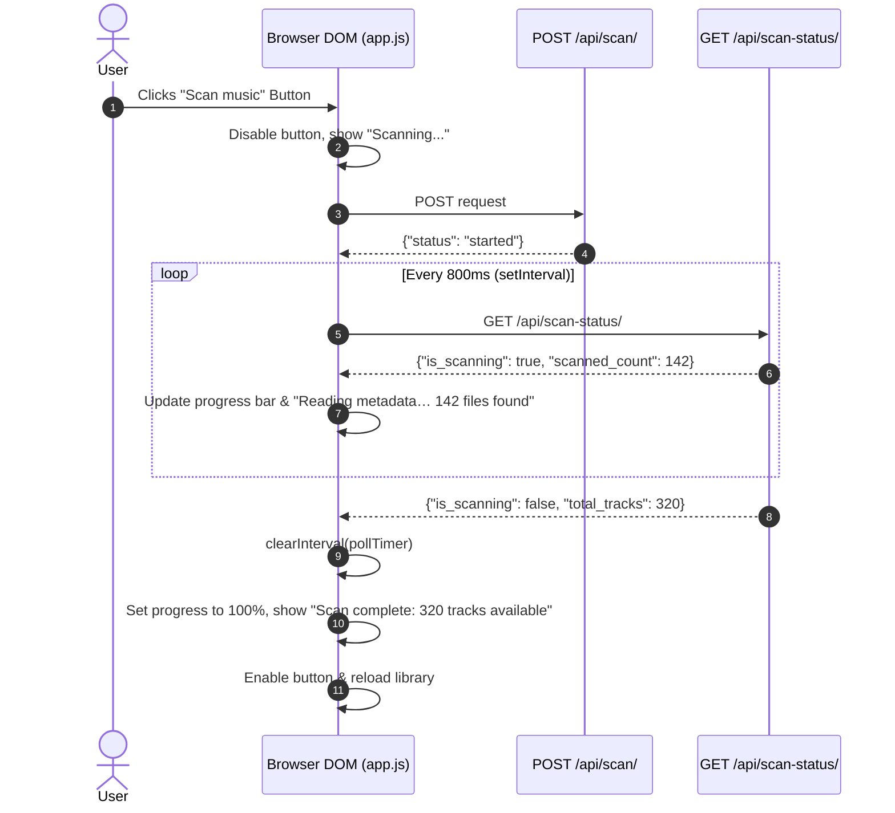

# SONORA — Monitoring, Telemetry & User Feedback Reference

> **Evaluation Category**: Monitoring & Feedback Systems  
> **Marks Allocated**: 5 Marks  
> **Project**: SONORA Tactile Studio Music Player  
> **Telemetry Protocols**: RESTful Polling · Thread Synchronization · Web Audio Analyser

---

## 1. Scan Progress & Real-Time Status Telemetry

The SONORA library scanner runs asynchronously in a background thread to prevent blocking HTTP requests. Real-time telemetry is managed through a thread-safe singleton pattern and exposed via REST APIs.

### 1.1 The `ScanState` Synchronization Model
In [`home/scanner.py`](file:///c:/Users/Theeran/Documents/Web%20App/home/scanner.py), the `ScanState` class acts as the centralized telemetry registry:

```python
class ScanState:
    def __init__(self):
        self.is_scanning = False
        self.scanned_count = 0
        self.total_tracks = 0
        self.last_scan = None
        self.errors = []
        self._lock = threading.Lock()

    def start(self):
        with self._lock:
            self.is_scanning = True
            self.scanned_count = 0
            self.errors = []

    def update_progress(self, count):
        with self._lock:
            self.scanned_count = count

    def finish(self, total, errors=None):
        with self._lock:
            self.is_scanning = False
            self.total_tracks = total
            self.last_scan = datetime.now().strftime("%Y-%m-%d %H:%M:%S")
            if errors:
                self.errors.extend(errors)

    def to_dict(self):
        with self._lock:
            current_total = self.total_tracks if self.is_scanning else Track.objects.count()
            return {
                "is_scanning": self.is_scanning,
                "scanned_count": self.scanned_count,
                "total_tracks": current_total,
                "last_scan": self.last_scan,
                "errors": self.errors[-5:] if self.errors else [],
            }
```

### 1.2 Thread-Safe Synchronization
- **Mutex Lock (`self._lock`)**: Guarantees that concurrent reads from Django WSGI worker threads (`GET /api/scan-status/`) never collide with mutations from the scanning worker thread (`update_progress()`).
- **Live Count Fallback**: When not actively scanning, `to_dict()` executes `Track.objects.count()`, ensuring total accuracy even if tracks were added externally.

### 1.3 Client Telemetry Polling Architecture
In [`home/static/home/app.js`](file:///c:/Users/Theeran/Documents/Web%20App/home/static/home/app.js), the frontend manages a high-frequency polling loop:



---

## 2. Application Logging & Diagnostic Tracing

SONORA utilizes Python’s standard `logging` module to emit structured diagnostic logs across all critical operations.

### 2.1 Key Logged Operations
- **Filesystem Security Warnings** (`home.scanner`):
  ```python
  logger.warning(f"Error checking path security for {file_path}: {e}")
  ```
  Alerts administrators if a request attempts path traversal outside `MUSIC_SCAN_DIRECTORIES`.
- **Metadata Fallbacks** (`home.scanner`):
  ```python
  logger.warning(f"Metadata extraction fallback for {file_path}: {e}")
  ```
  Logs unreadable ID3 tags, non-standard MPEG sync frames, or invalid RIFF chunks.
- **Artwork Fetch & Cache Diagnostics** (`home.artwork`):
  ```python
  logger.info(f"Online artwork lookup note for '{query}': {e}")
  logger.warning(f"Error reading artwork cache for track {track.id}: {e}")
  ```
  Traces cache misses, disk permission errors, and network lookup statuses.
- **Scan Lifecycle Summaries** (`home.scanner`):
  ```python
  logger.info(f"Music scan finished. Total tracks in library: {total}. Discovered: {len(discovered_files)}")
  ```

### 2.2 CLI Management Command Feedback
When executed from the command line (`python manage.py scan_music`), [`home/management/commands/scan_music.py`](file:///c:/Users/Theeran/Documents/Web%20App/home/management/commands/scan_music.py) outputs color-coded terminal telemetry:
- `self.style.NOTICE`: Starting directory notifications.
- `self.style.SUCCESS`: Total tracks and files scanned in the current pass.
- `self.style.WARNING`: Detailed list of warnings and errors encountered during the scan.

---

## 3. Real-Time User Feedback & Visual Observability

Beyond textual metrics, SONORA provides rich, multi-sensory feedback in the user interface:

### 3.1 Audio Frequency Reactive Glow (Ambient Aura)
The user interface features an ambient lighting aura that pulses and shifts color in direct response to the audio frequency spectrum:
- A `Web Audio API` `AnalyserNode` (`fftSize = 256`) processes audio frequencies in real-time.
- The low-frequency bass bins (0–6) are averaged to calculate dynamic amplitude (`lvl`):
  ```javascript
  an.getByteFrequencyData(fd);
  let s = 0;
  for (let i = 0; i < 6; i++) s += fd[i];
  lvl += ((s / 1530) - lvl) * 0.2;
  ```
- CSS custom properties (`--s`, `--h`, `--px`, `--py`) update the aura glow scale and position at 60 FPS via `requestAnimationFrame(frame)`.

### 3.2 Dynamic Vinyl Turntable Animation
- When playback is active (`playing === true`), the vinyl turntable disc (`heroDisc`) rotates with CSS animation.
- Center record label dynamically embeds the active track's cover art or Aurora gradient.
- Pausing halts the turntable smoothly.

### 3.3 Interactive Control Feedback
- **Equalizer Presets**: Dropdown selections immediately update all 10 frequency sliders (`AF = [60, 170, 310, 600, 1000, 3000, 6000, 12000, 14000, 16000] Hz`). Manual slider adjustments automatically set the preset indicator to `"Custom"`.
- **A–B Loop Indicator**: The `A–B` button visually toggles between three discrete states:
  1. Default: Inactive (`A–B`, `aria-pressed="false"`).
  2. A-Point Set: Point A recorded (`A–…`, waiting for Point B).
  3. Active Loop: Points A and B set (`A–B`, `aria-pressed="true"`, looping active).
- **Favorites & History Feedback**: Clickable heart icons immediately toggle state and persist across browser sessions in `localStorage`.

---

## 4. Administrative Troubleshooting Playbook

| Issue / Symptom | Diagnostic Command / Log Check | Remediation |
| :--- | :--- | :--- |
| **Scan is stuck or shows no progress** | Query `/api/scan-status/` in browser or check terminal output of `scan_music`. | Verify that scanning thread did not encounter a locked network share. Restart development server if necessary. |
| **Database file is locked (`OperationalError: database is locked`)** | Inspect if multiple background processes are writing simultaneously. | SQLite supports multiple concurrent readers but one writer. Ensure scans are not triggered concurrently (guaranteed by `SCAN_STATE.is_scanning` check). |
| **Web Audio effects produce no sound** | Check browser console for `The AudioContext was not allowed to start`. | Modern browsers enforce autoplay policies requiring user interaction. Click any play button to trigger `initAudio()` and `ctx.resume()`. |
| **High disk usage in media folder** | Inspect `.cover_cache/` and `media/covers/` directory sizes. | Cached album art files (`track_<id>.img`) average 40–80 KB. The cache can be safely purged if disk space is constrained; covers will re-extract on demand. |

---

## 5. Known Monitoring Limitations & Pending Tasks

1. **In-Memory ScanState Transient Persistence**:
   - *Current State*: `SCAN_STATE` is stored in server process memory (`home.scanner.SCAN_STATE`).
   - *Limitation*: If the server process restarts mid-scan, scan progress in memory is reset (though completed tracks are safely committed to the database via atomic transactions).
   - *Pending Task*: Store scan lifecycle records in a dedicated database model (`ScanHistory`) for audit tracking.
2. **Polling vs. WebSocket Telemetry**:
   - *Current State*: Frontend polls `/api/scan-status/` at 800ms intervals during scanning.
   - *Limitation*: Polling generates periodic HTTP requests during scans.
   - *Pending Task*: Upgrade to Django Channels / WebSockets or Server-Sent Events (SSE) for event-driven telemetry push.
